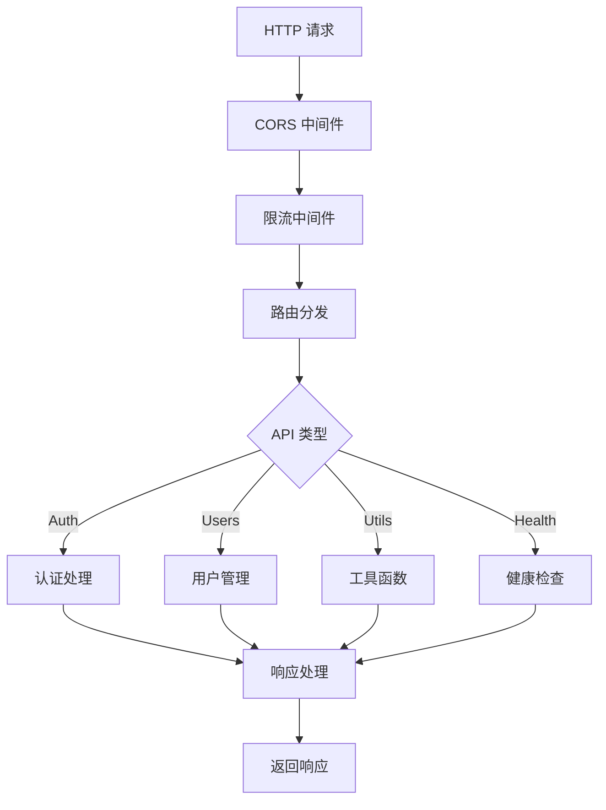

# 01-Workers 项目概览

## 📋 项目概述

01-Workers 是基于 Cloudflare Workers 构建的高性能边缘 API 服务，展示了完整的 Workers 开发最佳实践。项目采用模块化架构，包含认证、用户管理、工具函数等核心功能。

## 🏗️ 架构设计

### 核心架构
- **入口层**: `src/index.js` - 统一请求处理和路由分发
- **API 层**: `src/api/` - 按功能模块划分的 API 处理器
- **中间件层**: `src/middleware/` - 通用功能（CORS、认证、限流）
- **配置层**: `src/config/` - 环境变量和配置管理

### 技术栈
- **运行时**: Cloudflare Workers (V8 引擎)
- **语言**: JavaScript ES2022
- **认证**: JWT (JSON Web Tokens)
- **存储**: D1 (SQLite)、KV (键值存储)
- **测试**: Vitest
- **部署**: Wrangler CLI

## 📁 项目结构详解

```
01-workers/
├── src/                          # 源代码目录
│   ├── index.js                  # ✅ 主入口文件
│   │   ├── 路由分发系统
│   │   ├── 全局错误处理
│   │   ├── 中间件集成
│   │   └── 健康检查端点
│   ├── api/                      # API 模块
│   │   ├── auth.js               # ✅ 认证 API
│   │   │   ├── 用户登录/注册
│   │   │   ├── Token 生成/验证
│   │   │   ├── 会话管理
│   │   │   └── 密码安全处理
│   │   ├── users.js              # ✅ 用户管理 API
│   │   │   ├── CRUD 操作
│   │   │   ├── 分页查询
│   │   │   ├── 搜索功能
│   │   │   └── 权限控制
│   │   └── utils.js              # ✅ 工具 API
│   │       ├── 时间服务
│   │       ├── 哈希生成
│   │       ├── IP 信息
│   │       ├── Base64 编解码
│   │       ├── UUID 生成
│   │       └── JSON 验证/格式化
│   ├── middleware/               # 中间件
│   │   ├── cors.js               # ✅ CORS 处理
│   │   │   ├── 预检请求处理
│   │   │   ├── 源验证
│   │   │   └── 响应头添加
│   │   ├── auth.js               # ✅ JWT 认证
│   │   │   ├── Token 验证
│   │   │   ├── 会话检查
│   │   │   ├── 角色权限
│   │   │   └── 黑名单机制
│   │   └── rate-limit.js         # ✅ 限流系统
│   │       ├── IP 限流
│   │       ├── 用户限流
│   │       ├── 滑动窗口
│   │       └── 令牌桶算法
│   └── config/                   # 配置管理
│       └── env.js                # ✅ 环境变量
│           ├── 配置集中化
│           ├── 验证机制
│           ├── 敏感信息保护
│           └── 默认值管理
├── test/                         # 测试目录
│   ├── api.test.js               # ✅ API 测试套件
│   │   ├── 健康检查测试
│   │   ├── 认证流程测试
│   │   ├── 用户管理测试
│   │   ├── 工具 API 测试
│   │   ├── 错误处理测试
│   │   └── CORS 测试
│   └── fixtures/                 # 测试数据
│       └── users.json            # ✅ 用户测试数据
├── docs/                         # 文档目录
│   ├── 01.项目概览.md            # ✅ 本文档
│   ├── 02.API接口文档.md         # ✅ API 接口文档
│   └── 03.学习成果总结.md        # ✅ 学习成果总结
├── scripts/                      # 工具脚本
│   ├── test-api.sh               # ✅ API 测试脚本
│   │   ├── 完整的测试流程
│   │   ├── 彩色输出
│   │   ├── Token 管理
│   │   └── 结果统计
│   └── deploy-check.sh           # ✅ 部署前检查
│       ├── 文件检查
│       ├── 配置验证
│       ├── 安全扫描
│       └── 依赖检查
├── package.json                  # NPM 配置
├── wrangler.toml                 # ✅ Cloudflare 配置
│   ├── 多环境支持
│   ├── D1 数据库绑定
│   ├── KV 命名空间
│   ├── 环境变量
│   └── 定时任务
└── README.md                     # 项目说明
```

## 🚀 核心功能实现

### 1. 请求处理流程



### 2. 认证系统

- **JWT 实现**: 使用 Web Crypto API 生成和验证签名
- **会话管理**: KV 存储会话信息，支持过期时间
- **安全特性**: 密码哈希、Token 黑名单、恒定时间比较

### 3. 限流策略

- **固定窗口**: 基于时间窗口的简单限流
- **滑动窗口**: 更精确的限流控制
- **令牌桶**: 平滑的请求速率控制

### 4. 错误处理

- **统一错误格式**: JSON 格式的错误响应
- **错误分类**: HTTP 状态码与错误类型对应
- **日志记录**: 结构化的错误日志

## 🛠️ 开发指南

### 本地开发

```bash
# 启动开发服务器
npm run dev

# 使用管理脚本
../00-bin/01-workers-dev.sh

# 运行测试
npm test

# 运行 API 测试
./scripts/test-api.sh
```

### 部署流程

```bash
# 部署前检查
./scripts/deploy-check.sh

# 部署到开发环境
npm run deploy

# 部署到生产环境
npm run deploy -- --env production
```

### 环境配置

项目支持多环境配置：

- **development**: 开发环境，启用调试和模拟数据
- **staging**: 测试环境，使用真实数据
- **production**: 生产环境，优化配置

## 📊 性能特性

### 边缘计算优势
- **全球部署**: 自动部署到 Cloudflare 边缘节点
- **低延迟**: 毫秒级响应时间
- **高可用**: 99.9%+ 可用性保证

### 优化措施
- **CPU 限制**: 50ms CPU 时间限制
- **内存管理**: 128MB 内存限制
- **冷启动优化**: 快速初始化

## 🔒 安全特性

### 认证安全
- **JWT 加密**: HMAC-SHA256 签名
- **Token 过期**: 可配置的过期时间
- **会话管理**: 安全的会话存储

### 数据安全
- **输入验证**: 严格的参数验证
- **SQL 注入防护**: 参数化查询
- **XSS 防护**: 输出转义

### 网络安全
- **HTTPS 强制**: 自动 SSL/TLS
- **CORS 控制**: 精确的跨域配置
- **请求限流**: 防止 DDoS 攻击

## 📈 监控与日志

### 日志系统
- **结构化日志**: JSON 格式输出
- **日志级别**: debug, info, warn, error
- **上下文信息**: 请求 ID、用户 ID

### 监控指标
- **请求统计**: 请求量、响应时间
- **错误率**: 4xx/5xx 错误统计
- **资源使用**: CPU、内存使用情况

## 🧪 测试策略

### 测试覆盖
- **单元测试**: 核心函数测试
- **集成测试**: API 端点测试
- **端到端测试**: 完整流程测试

### 测试工具
- **Vitest**: 快速测试框架
- **Mock 数据**: 真实数据模拟
- **自动化脚本**: CI/CD 集成

## 📚 API 参考

详细的 API 文档请参考 [02.API接口文档.md](./02.API接口文档.md)

### 主要端点

| 端点 | 方法 | 描述 | 认证 |
|------|------|------|------|
| `/api/health` | GET | 健康检查 | ❌ |
| `/api/auth/login` | POST | 用户登录 | ❌ |
| `/api/auth/register` | POST | 用户注册 | ❌ |
| `/api/users` | GET | 用户列表 | ✅ |
| `/api/utils/hash` | POST | 生成哈希 | ❌ |
| `/api/utils/time` | GET | 服务器时间 | ❌ |

## 🔄 版本管理

### 语义化版本
- **主版本**: 不兼容的 API 修改
- **次版本**: 向后兼容的功能增加
- **修订版本**: 向后兼容的错误修复

### 版本历史
- **v1.0.0**: 初始版本，核心功能实现

## 🤝 贡献指南

### 开发流程
1. Fork 项目
2. 创建功能分支
3. 提交代码
4. 创建 Pull Request

### 代码规范
- **ESLint**: 代码风格检查
- **Prettier**: 代码格式化
- **TypeScript**: 类型检查（可选）

## 📞 支持与帮助

### 常见问题
1. **部署失败**: 检查 wrangler.toml 配置
2. **认证错误**: 验证 JWT 密钥配置
3. **限流问题**: 调整限流参数

### 获取帮助
- 查看日志: `wrangler tail`
- 项目 Issues: 在 GitHub 提交
- 官方文档: [Cloudflare Workers](https://developers.cloudflare.com/workers/)

---

## 📝 文档索引

1. **[01.项目概览.md](./01.项目概览.md)** - 本文档，项目整体介绍
2. **[02.API接口文档.md](./02.API接口文档.md)** - 详细的 API 接口文档
3. **[03.学习成果总结.md](./03.学习成果总结.md)** - 开发学习成果总结